# Chiron: a visual guide to the code

Read one numbered section at a time. Start with section 1; the function names become useful once the overall flow makes sense.

This guide describes the current local code, including changes awaiting review and push. GitHub only runs the code committed to its default branch.

## 1. What are we building?

An **earnings announcement** is a company's update about its business results. Chiron's eventual research question is whether information in that update helps identify stocks that perform better than the wider market over the next 20 trading days. A trading day is a day the stock market is open.

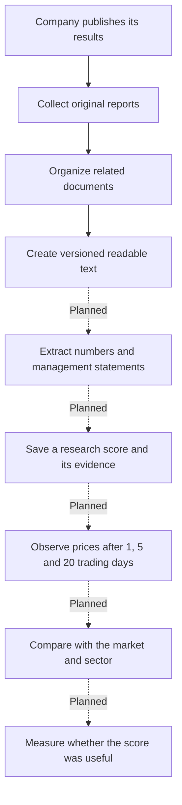

Solid arrows describe the collection pipeline implemented today. Dashed arrows describe future work. The Vue dashboard currently displays example data, including example scores and results; those are not live predictions.

The **SEC** is the US regulator that receives company reports. A **filing** is a report submitted to it. SEC **EDGAR** is the system where those filings can be retrieved.

## 2. Where does each part run?

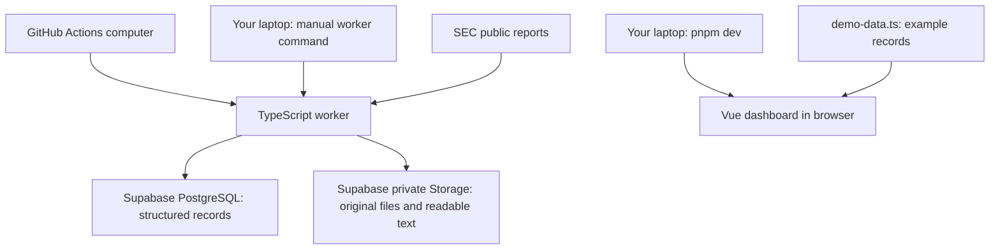

The worker is a command-line program that runs a job and exits. It is not a continuously running server. Supabase provides both PostgreSQL, which holds database rows, and Storage, which holds files such as `.htm` documents.

The dashboard currently reads `demo-data.ts`. There is no live dashboard connection to your Supabase data yet.

## 3. Repository and file map

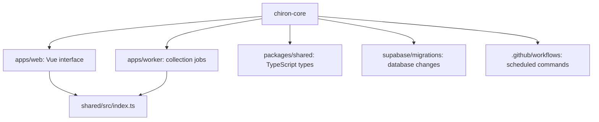

| File | What it does |
| --- | --- |
| `package.json` | Shortcuts for running, checking and building the whole repository. |
| `pnpm-workspace.yaml` | Tells pnpm which folders are packages. |
| `pnpm-lock.yaml` | Records the exact dependency versions installed. |
| `tsconfig.base.json` | Common TypeScript rules inherited by each package. |
| `.gitignore` | Keeps secrets, dependencies and build output out of Git. |
| `.env.example` | Documents the environment-variable names without real credentials. |
| `.github/workflows/sec-filings.yml` | Asks GitHub to run the collection jobs on a schedule or manually. |
| `apps/worker/src/index.ts` | Chooses and coordinates a worker command. |
| `apps/worker/src/load-env.ts` | Loads the local `.env` file when present. |
| `apps/worker/src/config.ts` | Loads database, SEC-request, and filing-sync configuration separately. |
| `apps/worker/src/sec.ts` | Retrieves SEC filing information and classifies report types. |
| `apps/worker/src/database.ts` | Reads and writes Supabase database rows. |
| `apps/worker/src/documents.ts` | Finds earnings attachments, downloads files and stores them. |
| `apps/worker/src/document-text.ts` | Converts archived SEC HTML into versioned readable text. |
| `apps/worker/src/financial-derived-metrics.ts` | Calculates versioned standard comparisons from extracted SEC values. |
| `apps/worker/src/qualitative-extraction.ts` | Prepares reproducible LLM inputs and validates exact source evidence without calling a provider. |
| `apps/worker/src/qualitative-input-loader.ts` | Selects and verifies one current and optional previous earnings release for a controlled extraction. |
| `apps/worker/src/qualitative-preview.ts` | Reports the exact input manifest and a rough size estimate without calling an LLM. |
| `apps/worker/src/qualitative-provider.ts` | Defines the provider-independent request, result, usage, and failure contract for qualitative extraction. |
| `apps/worker/src/baseline-qualitative-prompt.ts` | Builds the public `baseline-v6` prompt from reproducible current and previous documents. |
| `apps/worker/src/qualitative-evidence-passages.ts` | Splits source documents into stable evidence passages so the LLM selects evidence instead of copying quotes. |
| `apps/worker/src/openai-qualitative-provider.ts` | Sends one structured OpenAI Responses API request with automatic SDK retries disabled. Only the explicit paid command invokes it. |
| `apps/worker/src/qualitative-extraction-run.ts` | Validates and permanently stores one explicitly requested provider attempt without printing its source text or output. |
| `apps/worker/src/qualitative-extraction-review.ts` | Verifies and appends accepted, corrected, or rejected human review decisions without changing extraction history. |
| `apps/worker/src/canonical-json.ts` | Serializes JSON in stable key order before reproducibility fingerprints are calculated. |
| `apps/worker/src/content-hash.ts` | Creates SHA-256 fingerprints for original and derived files. |
| `apps/worker/src/storage.ts` | Persists immutable files and safely handles concurrent uploads. |
| `apps/worker/src/events.ts` | Groups related filings into earnings events. |
| `apps/worker/src/jobs.ts` | Records job start, success or failure. |
| `apps/worker/src/pagination.ts` | Loads database records in batches of 500. |
| `apps/worker/src/*.test.ts` | Checks selected parsing, grouping and pagination behaviors. |
| `apps/web/index.html` | Browser page containing the Vue mount point. |
| `apps/web/src/main.ts` | Starts Vue and imports the stylesheet. |
| `apps/web/src/App.vue` | Displays the demo interface and handles selecting a company row. |
| `apps/web/src/demo-data.ts` | Example events for the public demonstration. |
| `apps/web/src/styles.css` | Dashboard appearance and layout. |
| `apps/web/vite.config.ts` | Configures Vite, the frontend development/build tool. |
| `packages/shared/src/index.ts` | Exports data shapes used across packages. |
| `packages/shared/src/qualitative-extraction.ts` | Defines the runtime-validated qualitative JSON contract shared by the worker, future API, and UI. |
| `supabase/migrations/*.sql` | Creates and changes database tables, relationships and storage settings. |
| Each package's `package.json` | Its own dependencies and commands. |
| Each package's `tsconfig.json` | TypeScript settings specific to that package. |
| `docs/database.md` | Explains every database table. |
| `README.md`, `CONTRIBUTING.md`, `LICENSE` | Setup, contribution instructions and usage license. |

A TypeScript type describes what an object should look like. It does not fetch or save anything by itself, and it does not automatically validate external data at runtime.

## 4. How a command reaches a function

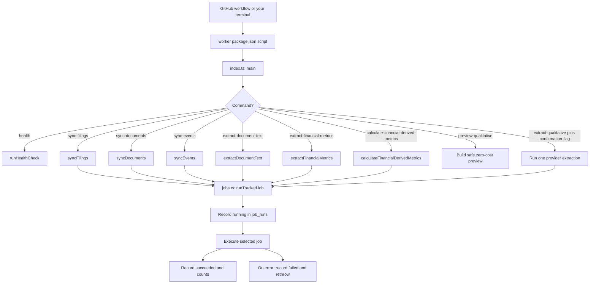

For example, `pnpm worker:sync-filings` at the repository root invokes the worker's `sync:filings` script, which runs `tsx src/index.ts sync-filings`. `tsx` executes TypeScript; `main()` reads `sync-filings` from the command-line arguments.

The GitHub workflow runs filings, documents, events, readable-text extraction, financial-metric
extraction, then standard financial calculations. A failed step stops the later steps. Health checks are not recorded through
`runTrackedJob()`.

The cron line requests hourly runs on weekdays in UTC. Actual execution can be delayed or skipped by GitHub. This is collection scheduling, not a precise prediction clock.

## 5. Job one: collect filing information

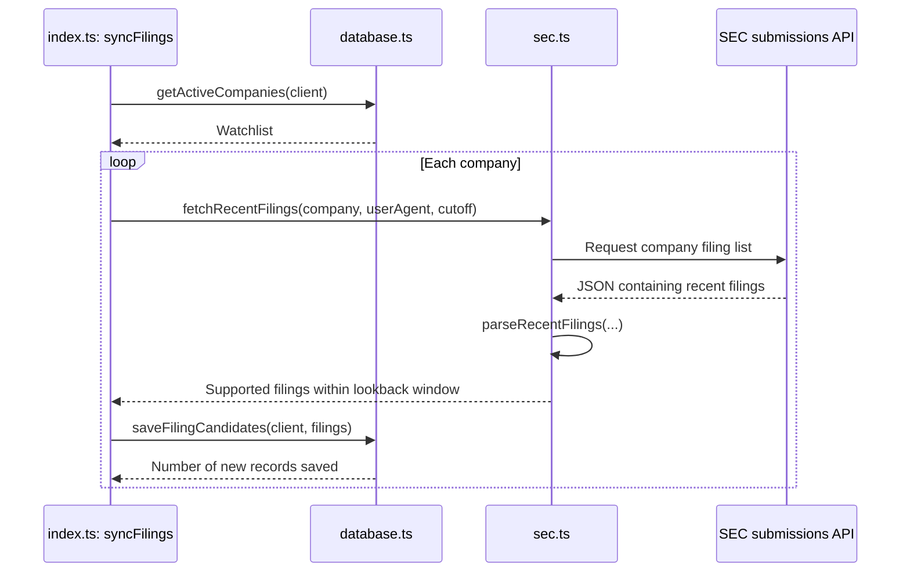

This step saves information *about* reports: company, report type, SEC document address and timestamps. It does not download the actual report files yet. Existing accession numbers are ignored, preserving their original first-seen time. An **accession number** is the SEC identifier for one filing.

| Function in `sec.ts` | Responsibility |
| --- | --- |
| `fetchRecentFilings()` | Request a company's recent filing list from the SEC. |
| `parseRecentFilings()` | Convert the SEC response into Chiron objects and filter by supported type/date. |
| `valueAt()` / `nullableValueAt()` | Read and clean a value from the SEC's parallel arrays. |
| `normalizeAcceptedAt()` | Convert the SEC acceptance timestamp into a consistent date string. |
| `buildSecIndexUrl()` | Build the address of the filing's attachment list. |
| `buildSecPrimaryDocumentUrl()` | Build the address of its main document. |
| `classifyEarningsFiling()` | Decide whether a filing matches the current earnings-related rule. |

The current request only reads the SEC's recent-filings response. Retrieving older SEC archive pages is future work.

## 6. Job two: download the documents

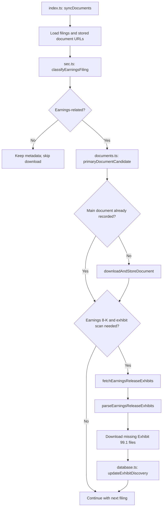

Report names in plain language:

| SEC name | Meaning |
| --- | --- |
| `10-Q` | A quarterly financial report. |
| `10-K` | An annual financial report. |
| `8-K` | A report announcing a significant company update. Only some concern earnings. |
| Item `2.02` | The part of an 8-K identifying business results. |
| Exhibit `99.1` | An attachment that often contains the earnings press release. |
| `/A` suffix | An amendment, or later revision, to a filing. |

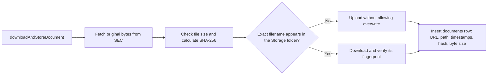

**SHA-256** is a fingerprint calculated from file contents. It helps identify which exact bytes were stored. Storage holds the file; the `documents` table holds its catalog record. Upload and database insert are separate operations, so a retry verifies an existing Storage object before recreating a missing database record.

Other helpers in `documents.ts`: `contentTypeFor()` identifies the fallback file format,
`storagePathFor()` and `storageFolderFor()` choose the bucket location,
`storageListingContainsDocument()` checks the exact filename, and `normalizeSecDocumentUrl()`
converts an attachment link to its document URL. Cheerio reads the SEC attachment-list HTML so the
parser can find Exhibit 99.1 rows.

## 7. Job three: connect related filings

An **earnings event** is one company update, potentially represented by several filings and files.

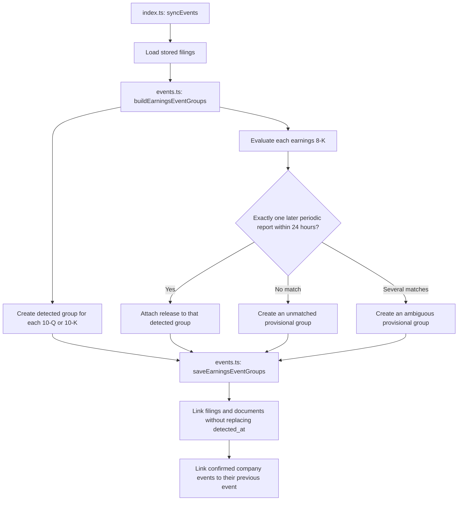

The 24-hour forward-only window matched all 40 earnings releases in the initial five-company sample; the largest gap was 13.52 hours. This is evidence for the first PoC, not a guarantee for other companies. The validation must be repeated when the watchlist expands.

`buildEarningsEventGroups()` calculates groups in memory. `saveEarningsEventGroups()` writes them to Supabase. Its helpers are `filingTimestamp()` for date comparisons, `eventKey()` for a company-and-period identifier, and `sameFilingIds()` for checking group membership.

`detected_at` means when Chiron created the event. It is preserved when an existing event changes. SEC publication times remain on source records. Grouping metadata is not an immutable prediction snapshot.

## 8. Job four: create versioned readable text

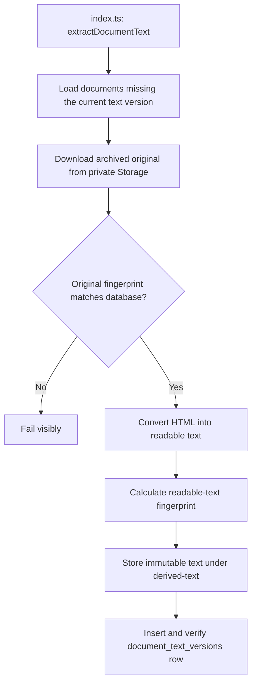

The original SEC HTML is not created by Chiron and is never changed. Chiron creates the readable
text as a separate derived artifact. A material converter change uses a new version, allowing older
outputs to remain reproducible. The future LLM step will use this readable text to produce
structured JSON; readable text and LLM JSON are separate stages.

The job processes documents sequentially to keep memory and service usage low. A partial run is
recoverable because completed document/version/fingerprint combinations are skipped next time.
Storage and database rows are both verified when concurrent workers reach the same deterministic
artifact.

## 9. Job five: extract basic inline-XBRL values

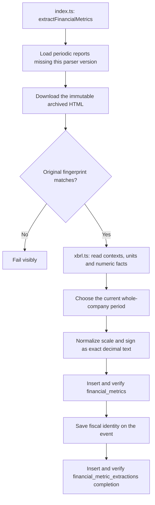

For a `10-Q`, the parser selects the shortest whole-company duration ending on the report date, so
the three-month quarter is not confused with the six- or nine-month year-to-date value. For a
`10-K`, it selects the full-year duration. XBRL dimensions identify facts for a segment, product, or
geography; version one excludes those facts and selects the consolidated company value.

The visible value may be `64,601` while its XBRL scale is `6`. The normalized value is therefore
`64601000000` USD. Both forms are retained: the normalized number supports calculations, while the
source fact text and XBRL attributes support review. A separate completion row makes partial
database failures recoverable and records missing-metric warnings without retrying forever.

## 10. Job six: calculate standard financial comparisons

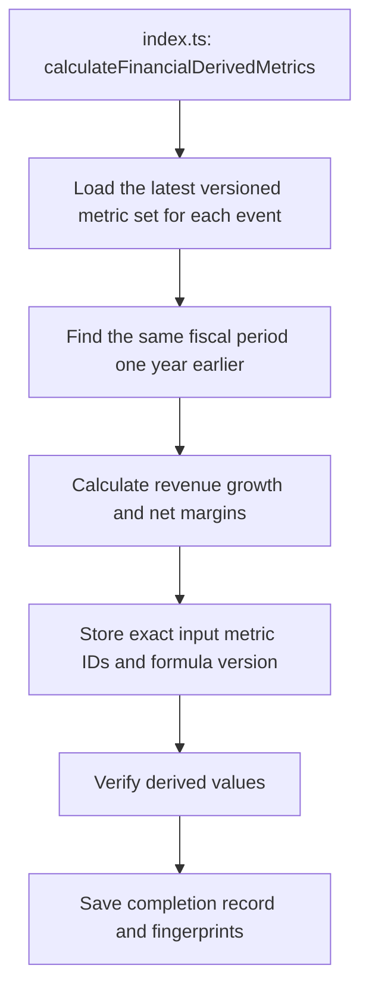

Quarterly results are compared with the same company quarter one fiscal year earlier; annual
results are compared with the preceding full year. This avoids treating a normal seasonal change,
such as holiday sales, as ordinary growth. Missing comparable data produces a stored warning and
does not cause endless retries. An amended filing creates a different input fingerprint, preserving
both the old and new calculations.

Net margin means `net income ÷ revenue`. Margin change is measured in percentage points: moving
from `15%` to `20%` is a five-percentage-point improvement. These formulas describe reported
results; they do not decide whether a stock is attractive.

## 11. How the database records connect

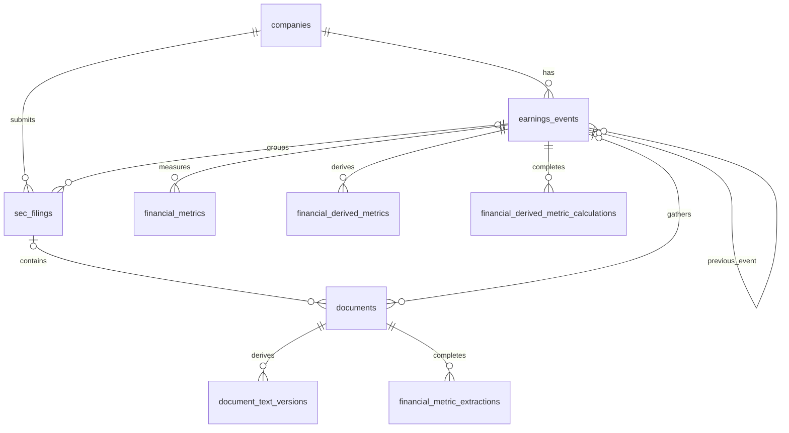

Read `companies → sec_filings` as: one company can have many filings. A filing can have no event yet, and a document can have no event yet. Each document points to its stored file through `storage_path`; the file itself is outside these database tables.

| Table | Current role |
| --- | --- |
| `companies` | Watchlist and company identifiers. |
| `sec_filings` | Filing catalog and classification/discovery results. |
| `documents` | File catalog, evidence timestamps and content fingerprints. |
| `document_text_versions` | Versioned readable-text artifacts derived from original documents. |
| `earnings_events` | Related filings grouped by company and reported period. |
| `job_runs` | Operational history of worker jobs. |
| `financial_metrics` | Versioned GAAP values with exact inline-XBRL evidence. |
| `financial_metric_extractions` | Completion and reproducibility record for each deterministic XBRL extraction. |
| `financial_derived_metrics` | Versioned revenue-growth and margin calculations with exact source metric IDs. |
| `financial_derived_metric_calculations` | Input manifests, warnings and completion records for derived calculations. |
| `extraction_runs` | Created for future LLM outputs and their input evidence. |
| `predictions` | Created for future research scores and snapshots. Update/delete protection is still planned. |
| `evaluations` | Created for future comparisons of stock and benchmark returns. |

Database migrations are applied separately. The GitHub collection workflow does not apply SQL migrations.

## 12. Configuration and database helper functions

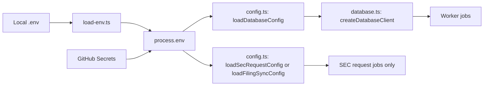

The local `.env` is ignored by Git. GitHub supplies environment variables separately. The Supabase secret key is used by the worker and must never enter Vue browser code.

| Function in `database.ts` | Responsibility |
| --- | --- |
| `createDatabaseClient()` | Create the Supabase client with server-side authentication settings. |
| `checkDatabase()` | Check access and count company rows. |
| `getActiveCompanies()` | Read the enabled watchlist. |
| `saveFilingCandidates()` | Insert filings while ignoring existing accession numbers. |
| `getFilingsForDocumentSync()` | Read filing records with company information, using pagination. Also used by event sync. |
| `getStoredDocumentSourceUrls()` | Read recorded document URLs, using pagination. |
| `getPendingDocumentsForTextExtraction()` | Read documents missing the requested text-extraction version. |
| `getPendingDocumentsForFinancialMetricExtraction()` | Read periodic reports missing the requested XBRL-parser version. |
| `updateFilingClassification()` | Save the versioned decision about relevance to earnings. |
| `updateExhibitDiscovery()` | Save which attachments were found and when the index was checked. |
| `createJobRun()` / `finishJobRun()` | Record the lifecycle and results of a job. |
| `versionFromJson()` / `parseClassification()` | Interpret stored JSON fields. |

`pagination.ts: fetchAllPages()` requests rows in batches of 500, collecting them until the last batch. Callers provide stable ordering. `jobs.ts: runTrackedJob()` wraps a job with database history and propagates failures to the command-line process.

## 13. Vue: the part familiar to a frontend engineer

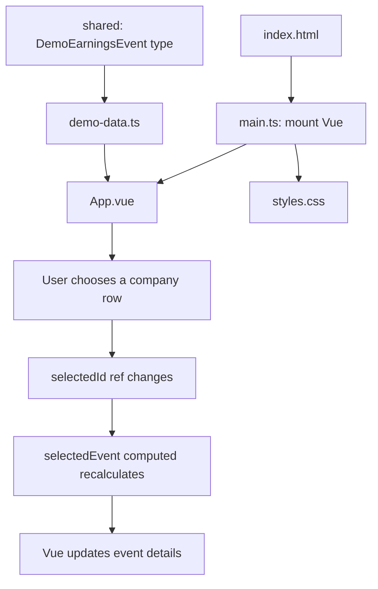

`scoreLabel()` formats positive numbers with a `+`. The example records supply scores, guidance and results. The demo's displayed processing stages illustrate the intended product; they are not evidence that extraction or prediction jobs are running. Some navigation links and buttons are placeholders.

## 14. The future evaluation pipeline

The end-to-end jobs below are planned; they do not exist yet.

The provider-independent qualitative schema, input-manifest fingerprinting, and exact evidence
validation are implemented foundations. A public baseline prompt, OpenAI adapter, zero-cost
preview, and explicitly paid single-event command are implemented and covered by mocked tests. The
command stores provider and evidence-validation results in `extraction_runs`; it has no automatic
retry and is not scheduled. Scoring and evaluation jobs remain planned.

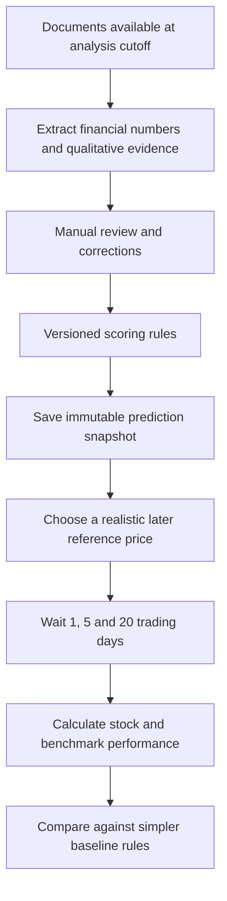

The **analysis cutoff** is the latest time from which information is allowed into a prediction. A **benchmark** is a comparison, such as the S&P 500 or a group of companies in the same industry. A **baseline** is a simpler approach used to check whether our extra analysis adds value.

The signal score and source coverage must remain separate. The MVP records which source categories
were included or excluded from each qualitative input. Finding no risk in the supplied earnings
releases means **unknown**, not **safe**, and cannot add positive points. Future scoring can show a
coverage warning or confidence label, but it must not silently convert missing information into a
better score.

For example, an analysis completed after market close cannot claim the earlier closing price as an available entry. Historical grouping must also filter each source by its availability time; a later report or amendment cannot be used in an earlier prediction.

## 15. Suggested reading path

1. Start with sections 1–3 to understand the purpose and locations.
2. Read `index.ts: main()` alongside section 4.
3. Follow `syncFilings()` and `sec.ts` alongside section 5.
4. Follow `syncDocuments()` and `documents.ts` alongside section 6.
5. Follow `syncEvents()` and `events.ts` alongside section 7.
6. Follow `extractDocumentText()` and `document-text.ts` alongside section 8.
7. Use sections 9–12 while reading financial extraction, calculations, migrations and database operations.
8. Read the Vue files alongside section 13.
9. Keep section 14 separate from today's implemented behavior.
